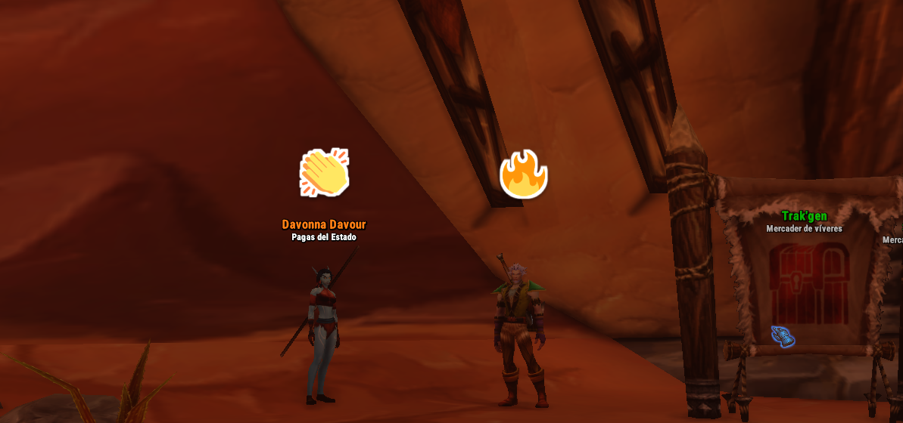
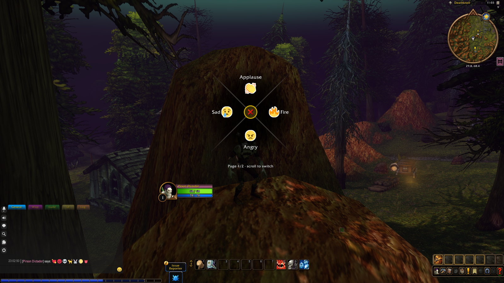
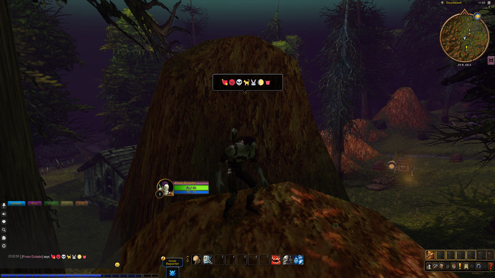
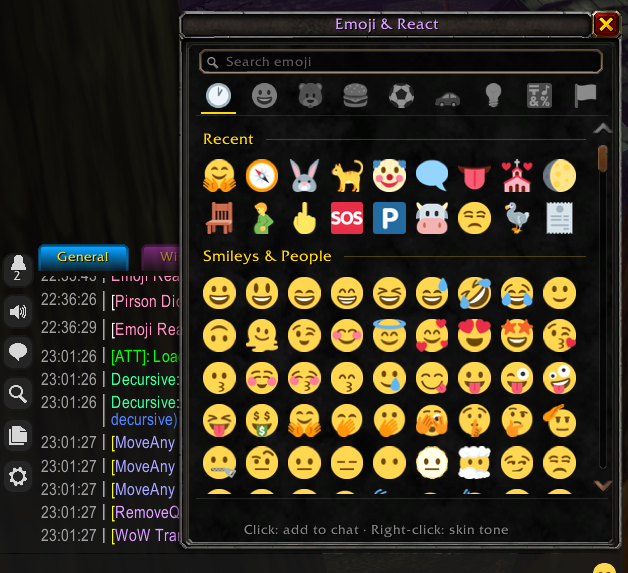
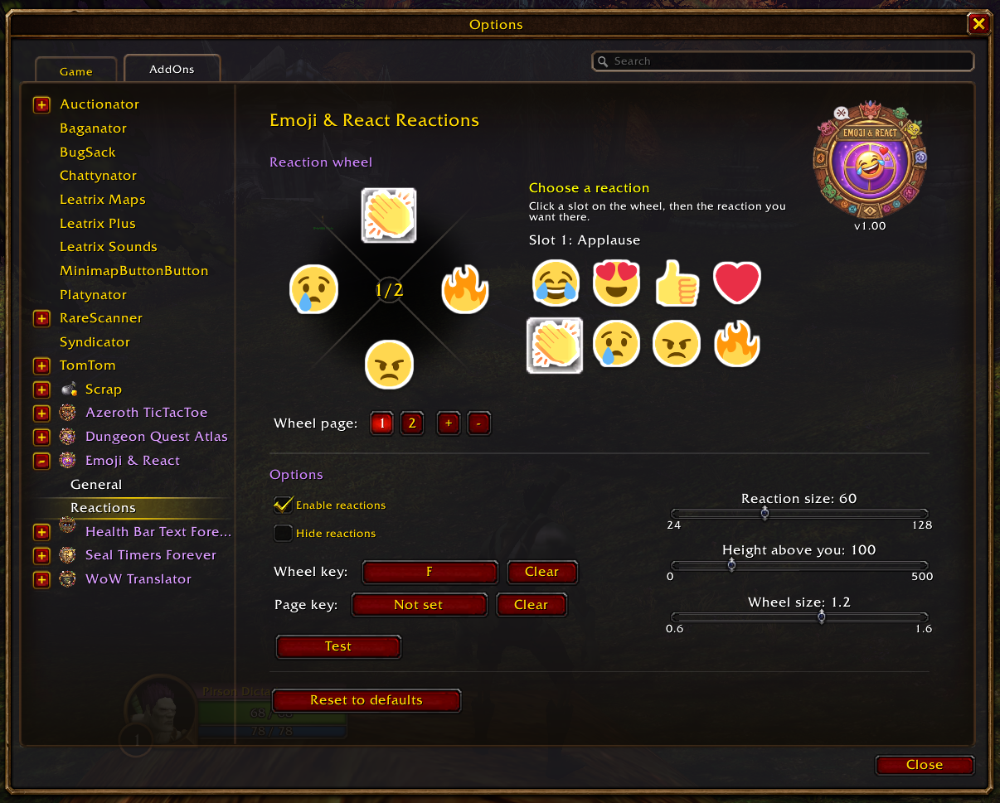
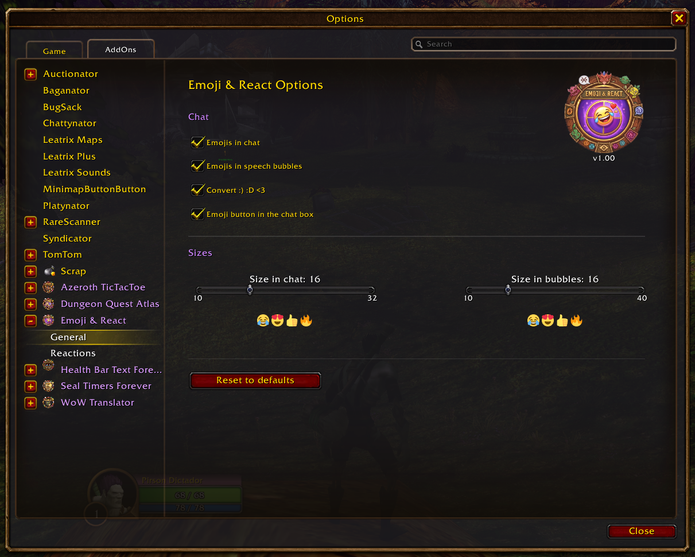

<a href="README.md">English</a> · <b>Español</b>

<a href="https://www.curseforge.com/wow/addons/emoji-react"><b>CurseForge</b></a> ·
<a href="https://github.com/Pirson-s-Addons/EmojiReact/releases/latest"><b>Descargar</b></a>

## Capturas

<table>
<tr>
<td align="center" width="50%"> Reacciones en movimiento</td>
<td align="center" width="50%"> Panel de emojis</td>
</tr>
<tr>
<td align="center" width="50%"> Emojis en el chat y los bocadillos</td>
<td align="center" width="50%"> Rueda de reacciones</td>
</tr>
<tr>
<td align="center" width="50%"> Reacciones sobre los jugadores</td>
<td align="center" width="50%"> Tu propia reacción</td>
</tr>
<tr>
<td align="center" width="50%"> Personaliza la rueda</td>
<td align="center" width="50%"> Opciones</td>
</tr>
</table>

## Qué hace

**Emoji & React** trae los emojis de siempre al chat y a los bocadillos de WoW Forever, y añade una **rueda de reacciones**: mantén una tecla, apunta con el ratón hacia una reacción, suelta, y aparecerá encima de tu personaje para los jugadores cercanos que también tengan el addon.

| Escribes | Ves |
|---|---|
| `:joy:` `:heart_eyes:` `:thumbsup:` | el emoji, en el chat y en el bocadillo |
| `:)` `:D` `<3` `xD` | el emoji equivalente |
| un emoji pegado (Win + .) | el emoji en vez de un cuadro vacío |

| | |
|---|---|
|  |  |
|  |  |
|  |  |

## Funciones

- **Todos los emojis** (1.900 más sus tonos de piel) en el chat y en los bocadillos de /decir, /gritar y grupo, escritos como `:joy:` (códigos de Discord/Slack) o pegados.
- **Panel de emojis como el de WhatsApp** desde un botón en la caja de chat: buscador en tu idioma, categorías, recientes y tonos de piel (clic derecho en un emoji).
- **Reacciones con imágenes propias**, distintas de los emojis del chat, también de PvP (**GG, WP, EZ, 1V1, RIP, LOL**). Aparecen como los emojis de Fortnite: entran rebotando, se balancean y estallan al irse.
- También convierte los emoticonos clásicos (`:)`, `:D`, `<3`...) sin tocar enlaces ni URLs.
- Rueda de reacciones igual que la **Ping Wheel** del propio juego: mantén **la tecla que tú elijas** (tecla, combinación o botón del ratón), apunta con el ratón hacia una reacción y suelta; soltando en la X del centro se cancela. Páginas de 4 reacciones (una por cada 4 imágenes de reacción) que cambias con la rueda del ratón o con la tecla que elijas, todas elegidas por ti.
- Los ajustes están en el panel del propio juego, **Opciones → AddOns**: tamaños, qué convertir, la tecla de la rueda, sus reacciones y la altura de tu propia reacción.
- Ligero, sin librerías.

## Uso

- `/emoji` abre los ajustes. `/emoji wheel` abre el panel de reacciones. `/emoji panel` abre el panel de emojis (también desde el botón de la caja de chat o su atajo de teclado). `/emoji key` elige la tecla de la rueda. `/emoji test` muestra una reacción encima de ti.
- **Opciones → AddOns → Emoji & React → General**: chat y bocadillos.
- **Opciones → AddOns → Emoji & React → Reacciones**: la rueda tal como se ve en el juego. Haz clic en un hueco y elige su reacción, añade o quita páginas, y ajusta la tecla, los tamaños y la altura.
- Las reacciones de **los demás** salen encima de su placa de nombre. Si no usas placas amistosas, el addon las enciende solo lo que dura la reacción y luego las deja como estaban. *Ocultar reacciones* oculta las de los demás, y entonces el addon no toca las placas.

## Instalación

1. Descarga el zip de [CurseForge](https://www.curseforge.com/wow/addons/emoji-react) o de la [última release](https://github.com/Pirson-s-Addons/EmojiReact/releases/latest).
2. Extrae la carpeta `EmojiReact` en `World of Warcraft/_forever_/Interface/AddOns/`.
3. Reinicia el juego y activa el addon.

## Notas

- El mensaje se sigue enviando como texto (`:joy:`): quien no tenga el addon ve el texto, como con cualquier addon de emojis.
- **Dentro de mazmorras y bandas** Blizzard no deja a los addons leer el chat ni tocar los bocadillos y las placas amistosas: ahí no hay emojis en el chat ni en los bocadillos, y las reacciones de tu grupo salen junto a su marco de grupo en vez de encima de ellos.
- Tu personaje no tiene placa de nombre, así que tu reacción se coloca encima del centro de la pantalla. Ajusta *Altura sobre ti* a tu zoom de cámara.

**Autor**: Pirson · [GitHub](https://github.com/Pirson-s-Addons) · [CurseForge](https://www.curseforge.com/members/pirson/projects) · Licencia MIT · Gráficos de los emojis: [Twemoji](https://github.com/jdecked/twemoji) (CC-BY 4.0) · Datos de los emojis: [emojibase](https://emojibase.dev) (MIT)

 

